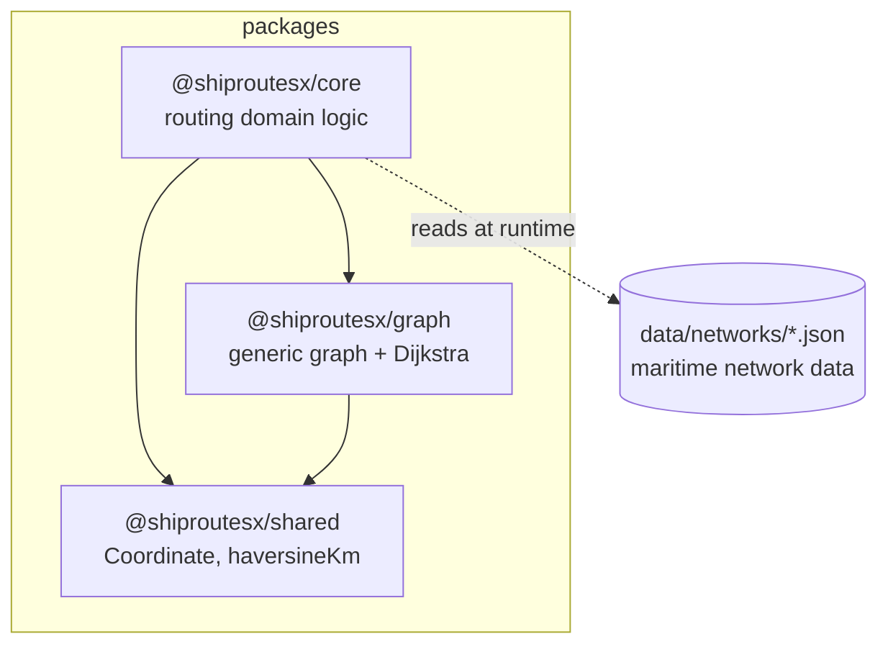
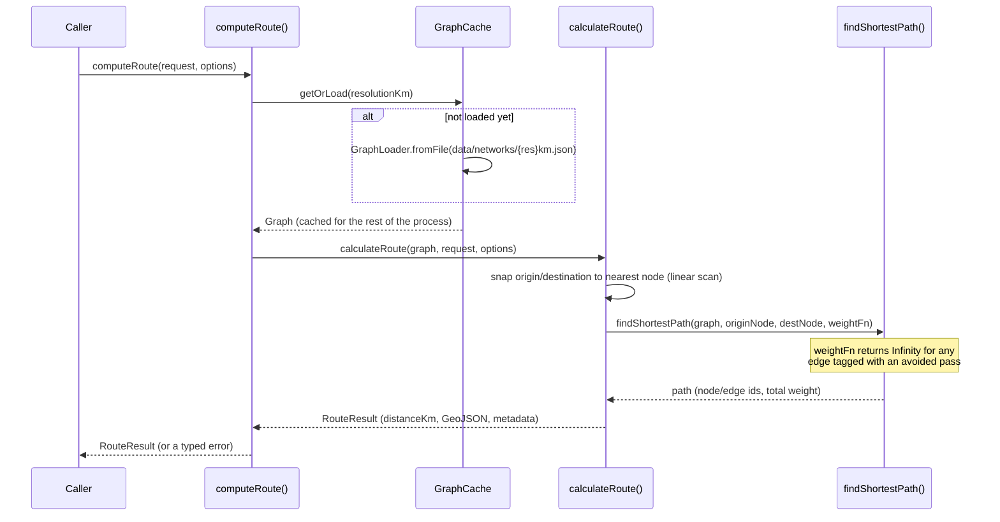

# Architecture

This document describes how the **ShipRoutesX routing engine** is built. For the Java project that inspired it, see [`searoute-architecture-analysis.md`](searoute-architecture-analysis.md). The HTTP API, the website and the (mocked) auth layer around the engine are kept in a separate private repository, which includes this repo as a Git submodule.

## System overview

This repo is an npm-workspaces monorepo of three TypeScript packages with a strict, one-way dependency graph, plus the network and zone data.



One thing about this graph is load-bearing, not incidental: **`packages/core` and `packages/graph` never import an HTTP framework.** The routing engine is a plain TypeScript library. You can put an HTTP API, a CLI or a different framework in front of the same engine without touching it, and nothing in this repo depends on the API that does so today.

## Package responsibilities

| Package               | Owns                                                                                                                                  | Does NOT own                                                                   |
| --------------------- | ------------------------------------------------------------------------------------------------------------------------------------- | ------------------------------------------------------------------------------ |
| `@shiproutesx/shared` | `Coordinate` type, `haversineKm` (great-circle distance)                                                                              | Anything maritime- or graph-specific                                           |
| `@shiproutesx/graph`  | `Node`/`Edge`/`Graph`, `GraphLoader` (validation), `GraphCache` (load-once-per-resolution), `findShortestPath` (binary-heap Dijkstra) | Maritime rules: no concept of "chokepoint" or "ship" anywhere in this package |
| `@shiproutesx/core`   | Network loading (`loadMaritimeGraph`), route computation (`calculateRoute`/`computeRoute`), `RouteOptions`, ECA and piracy zone analysis, the error hierarchy | HTTP, request/response shapes, wire formats                       |

## Route computation



There are two entry points in `@shiproutesx/core`:

- **`calculateRoute(graph, request, options)`**: pure, synchronous, no I/O. Takes an already-loaded `Graph`. This is what unit tests call directly with small fixture graphs.
- **`computeRoute(request, options)`**: async. Resolves _which_ resolution's graph to use, loads and caches it via `GraphCache`, then calls `calculateRoute`. This is what an HTTP layer calls.

## Data model

A maritime network is a plain JSON file (`data/networks/{5,10,20,50,100}km.json`):

```json
{
  "resolutionKm": 20,
  "nodes": [{ "id": "marseille", "lon": 5.3, "lat": 43.3 }],
  "edges": [
    { "id": "e4", "from": "marseille", "to": "piraeus", "distanceKm": 1653.3, "pass": null }
  ]
}
```

`GraphLoader` validates this shape (unique ids, no dangling edge references, positive distances) before building an immutable `Graph`. `Graph` precomputes an adjacency index at construction, so `incidentEdgeIds(nodeId)` is a map lookup, not a scan. This is the one precomputation step that happens eagerly; everything else about a `Graph` is read-only after that.

An edge's optional `pass` field names the strait, canal or passage it transits (`"suez"`, `"panama"`, ...). `RouteOptions.avoid` blocks routes through named passes by turning the corresponding edges' weight to `Infinity` for that one request. The graph itself, and the Dijkstra implementation, are never modified or aware that "avoidance" is a maritime concept at all.

## Key design decisions and why

| Decision                                                                                            | Why                                                                                                                                                                                                                                    |
| --------------------------------------------------------------------------------------------------- | -------------------------------------------------------------------------------------------------------------------------------------------------------------------------------------------------------------------------------------- |
| One typed `RouteOptions` object, not a boolean per strait                                           | The Java project this is inspired by took 12 boolean parameters on `getRoute` (see [SeaRoute analysis §17.4](searoute-architecture-analysis.md)). Adding a new option now means adding a field, not another parameter to every call site. |
| A typed error hierarchy (`RouteValidationError` / `RouteNotFoundError` / `NetworkUnavailableError`) | Lets an HTTP layer map each _kind_ of failure to the right status without parsing error message text.                                                                                                                                  |
| Binary-heap Dijkstra (`MinHeap`) instead of a linear scan for node selection                        | `O((V+E) log V)` instead of `O(V²)`, a real, tested algorithmic upgrade.                                                                                                                                                               |
| Nearest-node lookup is still a linear scan                                                          | A documented, intentional choice that is acceptable at current sizes. A spatial index is the natural next step, tracked in the [Roadmap](../README.md#roadmap).                                                                         |
| `GraphCache` caches per resolution, never invalidates, never reloads                                | Matches "load once, cache in memory, immutable after loading." A failed load isn't cached, so a transient failure can be retried.                                                                                                      |
| Zone analysis lives in `packages/core`, driven by data in `data/zones`                              | ECA and piracy polygons change by date and region; keeping them as data with an `as_of` date means rule changes do not touch routing code.                                                                                             |

## What's intentionally not built yet

- **Antimeridian (±180°) handling**: routes crossing the international date line aren't stitched together specially yet.
- **A spatial index for nearest-node lookups**: see the table above.
- **Canadian Arctic and Norwegian Sea ECAs**: see [`data/zones/README.md`](../data/zones/README.md).

None of these are omissions discovered by accident; each is a deliberate, documented scope boundary. See the [Roadmap](../README.md#roadmap) for what's next.
